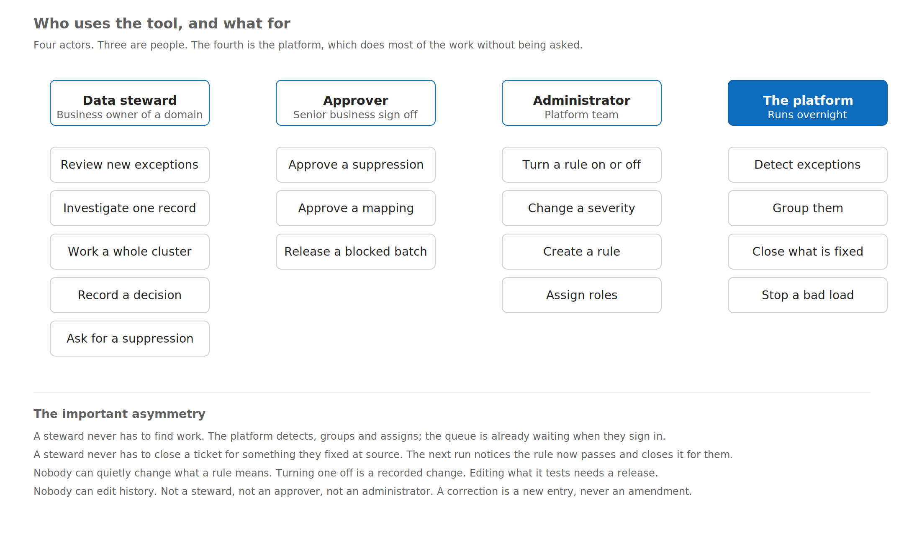
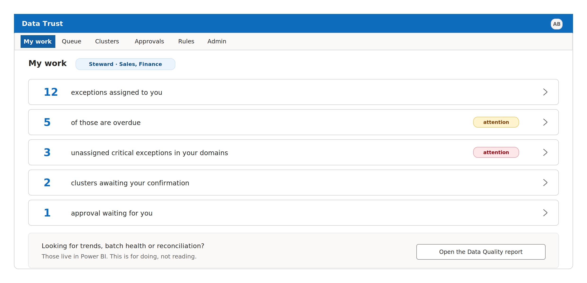
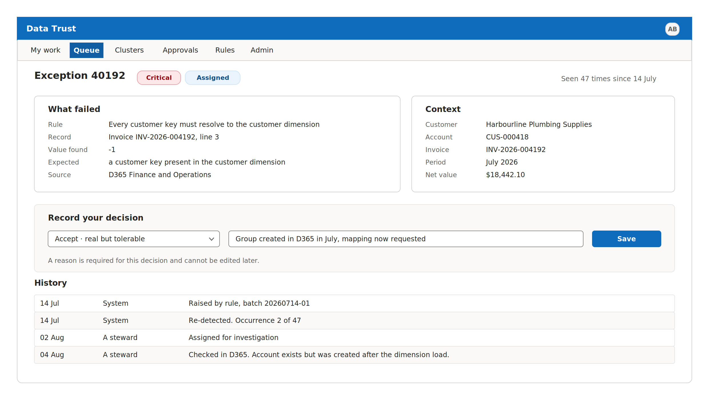
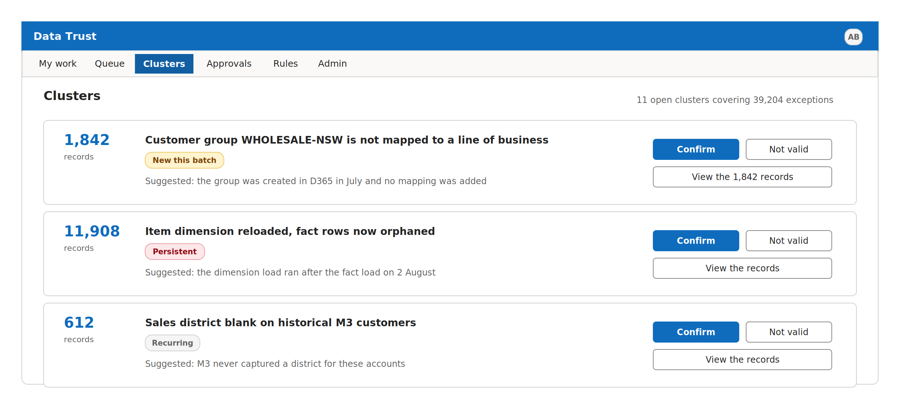
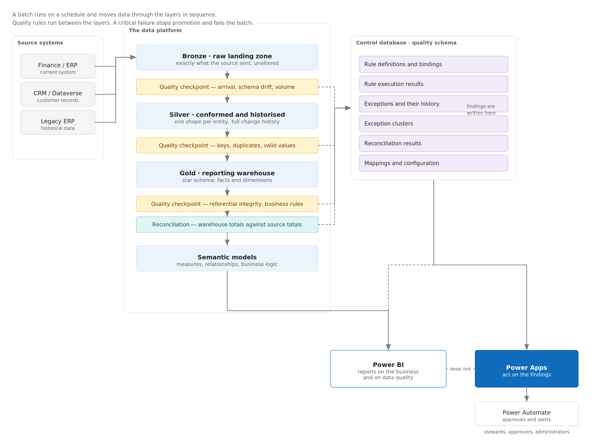

# DQ App — Data Quality & Exception Management

A Power Apps canvas app that lets data stewards, approvers and
administrators triage data-quality exceptions, work them in clusters,
request suppressions, and manage the rules that generate them — backed by a
SQL Server data source.

- **Display name:** DQ Test App
- **Source environment:** `dq-dev`
- **Data source:** Azure SQL (`shared_sql` connector)
- **Form factor:** Tablet, 1366×768

## The problem

Data moves from the operational source systems into the reporting
warehouse every night. Most of it arrives correctly. Some of it doesn't.

Without a tool like this, the way anyone finds out is indirect: a number in
a report looks wrong, someone queries it, someone else exports a
spreadsheet and compares it against the source system by hand — and
eventually finds, say, a customer that was never mapped, or a load that ran
in the wrong order. That takes days, it happens after the figures have
already been circulated, and whatever was learned goes into an email
nobody can find six months later.

Three things follow from that pattern, and all three are expensive:

- **Problems are found by their consequences, not their causes.** By the
  time a report looks wrong, the bad data has already been in it for a
  month.
- **The same investigation gets repeated.** Nothing records that this
  exact problem was looked at in March and judged acceptable, so it gets
  investigated again in June.
- **Nobody can answer the question that matters.** Asked whether the
  warehouse agrees with the source system, the honest answer has been
  "someone would need to check."

### What the app does about it

| It does this | Which means |
|---|---|
| Checks every load against a catalogue of rules | Problems are found the night they arrive, not the month they surface in a report |
| Holds each problem as an item with an owner | A defect is somebody's work, not an alert in a mailbox |
| Groups related problems automatically | Forty thousand records failing one mapping is one decision, not forty thousand |
| Records every decision permanently | The reason a figure was accepted is attached to it, not sitting in somebody's inbox |
| Reconciles the warehouse to the source system | "Does this agree with the source?" has an answer, produced nightly |
| Stops a bad load rather than publishing it | A serious defect halts promotion instead of quietly reaching a report |

It is **not** a report (that's Power BI's job — this is a place to *act*,
not read), not a replacement for fixing data at source (nothing here edits
the source systems; it records the decision), and not an approval workflow
for everyday changes (only suppressing a rule and changing a reference
mapping need sign-off).

**Roles:**



## What the app looks like

The landing screen surfaces what needs attention without the steward
having to go looking for it:



Exceptions open to a detail view with what failed, the record's context,
and a required, permanent decision + reason:



Related exceptions are grouped into clusters, so one root cause is one
decision instead of thousands of individual rows:



## The data

The app is a thin UI over a SQL Server control database (`dq` schema) with
roughly **30 tables across five subject areas**. Four tables carry the
load; everything else supports one of them:

| Table | Carries |
|---|---|
| `dq.Rule` | What to test, in business terms |
| `dq.RuleBinding` | Where to test it, and how hard to press — one row per rule per dataset per environment |
| `dq.RuleExecution` | One binding, run once, against one batch — an **event** |
| `dq.Exception` | A defect that persists across executions, identified by fingerprint rather than by row — a **state** |

The distinction between the last two is deliberate: collapsing an
*execution* (an event) into an *exception* (a state) is what turns a
data-quality capability into an alert feed nobody reads.

**Subject areas:**

1. **Security, reference & configuration** — `UserRole`, `Lookup`,
   `StatusTransition`, `Config`: the vocabulary and lifecycle every other
   table reads.
2. **Rule registry** — `RuleTemplate`, `Rule`, `RuleBinding`,
   `RuleTemplateInstance`, `RuleVersion`: what gets tested, and an
   immutable, hash-keyed snapshot of each version that ran.
3. **Execution, exceptions & workflow** — `RuleExecution`,
   `ExceptionStaging`, `Exception`, `ExceptionHistory`, `ExceptionCluster`,
   `ExceptionClusterMember`, `Suppression`, `RejectStore`,
   `NotificationQueue`, `BatchGateResult`: the findings, their lifecycle,
   and what gates a batch.
4. **Reconciliation & anomaly detection** — `ReconciliationControl`,
   `ReconciliationResult`, `VarianceNarrative`, `MetricObservation`,
   `MetricBaseline`: proving the warehouse agrees with the source, and
   flagging metrics that drift outside their normal band.
5. **Mapping, profiling & AI** — `MappingSet`, `MappingEntry`,
   `ProfileRun`, `ColumnProfile`, `RuleSuggestion`, `AiInvocation`:
   reference mappings, column profiling, and AI-assisted rule suggestions.

**Conventions worth knowing when reading the YAML/SQL:**

- Every editable table carries a `ROWVERSION`; a stale write returns
  `CONFLICT` rather than silently overwriting a decision made against
  information that's since changed.
- Timestamps are `DATETIME2(3)` UTC via `SYSUTCDATETIME()` — no local time
  anywhere.
- Nothing is soft-deleted or edited after the fact. Exceptions close,
  mappings end-date, suppressions expire; a correction is a new history
  row, never an amendment to an old one.
- `Context`/`Scope`/`Evidence`/`Payload` columns are JSON-in-`VARCHAR`,
  read with `JSON_VALUE` — which is how one detail screen renders an
  invoice, a customer, or a service order with no per-entity code.

The connection this app uses is scoped (via the connector's execution
policy) to exactly 17 stored procedures — see `src/References/DataSources.json`
for the full list and their parameter shapes.

**Architecture — where this app sits in the platform:**



## Repo layout

```
docs-images/  Screenshots and diagrams pulled from the design docs (see below)
package/      The canonical app export (.zip from Power Apps "Export package")
src/          Unpacked canvas-app source — this is what's reviewable/diffable
```

Design docs (user guide, database design, module handover) exist locally
but are **not** pushed here — they're internal/confidential. The images
above were pulled from them because they don't carry anything sensitive on
their own.

### `src/`

This is the output of unpacking the `.msapp` inside `package/`. The
interesting part is `src/Src/*.pa.yaml` — the Power Fx formulas and control
trees for each screen, in Microsoft's YAML source format:

| File | Screen |
|---|---|
| `App.pa.yaml` | App-level `OnStart`/`OnError`, globals (`gblActorUpn`, `gblCfg`, `gblError`) |
| `scrLoading.pa.yaml` | Bootstrap / scope load |
| `scrMyWork.pa.yaml` | My Work landing tiles |
| `scrQueue.pa.yaml` | Exception queue, filters, bulk disposition |
| `scrExceptionDetail.pa.yaml` | Single exception detail, decision, history |
| `scrClusters.pa.yaml` | Cluster confirm/reject |
| `scrApprovals.pa.yaml` | Suppression approvals |
| `scrSuppression.pa.yaml` | Suppression request form |
| `scrRules.pa.yaml` | Rule binding admin |
| `scrNoAccess.pa.yaml` | No-access fallback |

`src/AppCheckerResult.sarif` is the App Checker report captured at export
time — see **Known issues** below.

`src/References/DataSources.json` documents the full set of stored
procedures the connection is scoped to:

```
dq.usp_getmyscope          dq.usp_getexceptiondetail      dq.usp_getpendingapprovals
dq.usp_getlookup            dq.usp_getexceptionhistory     dq.usp_approvesuppression
dq.usp_getmywork            dq.usp_setexceptionstatus      dq.usp_getrulelist
dq.usp_getexceptionqueue    dq.usp_addexceptioncomment     dq.usp_requestsuppression
dq.usp_bulkdisposition      dq.usp_getclusterlist          dq.usp_getruledetail
                             dq.usp_confirmcluster          dq.usp_updaterulebinding
```

## Re-importing / editing

- **To open in Power Apps Studio:** import `package/DQApp_20261010010044.zip`
  via [make.powerapps.com → Apps → Import canvas app](https://make.powerapps.com),
  and point the SQL connection at your own database.
- **To re-generate `src/` after editing in Studio:** export a new package,
  then unpack the `.msapp` inside it with the
  [Power Platform CLI](https://learn.microsoft.com/power-platform/developer/cli/introduction):
  ```
  pac canvas unpack --msapp path/to/document.msapp --sources src
  ```
  (This repo's `src/` was produced the same way, minus `_EditorState.pa.yaml`,
  which is gitignored — it's per-user editor layout state, not app logic.)
- **To pack edited YAML back into a `.msapp`:**
  ```
  pac canvas pack --sources src --msapp document.msapp
  ```

## Known issues

The App Checker report captured at export time
(`src/AppCheckerResult.sarif`) flags 345 findings, including real formula
errors that should be fixed before this is treated as a working baseline:

- **`scrMyWork.txtRolePillMW.Text`** — invalid `Concat` call / bad identifier `Result`
- **`scrExceptionDetail.OnVisible`** — `Set(gblError, {...})` passes a Boolean where `gblError` is expected to be a record/table consistently (`ErrBadType`)
- **`scrQueue.OnVisible`** — `"Code"` used where an identifier is expected (19 occurrences)
- **`scrQueue.drpDomainQU.OnChange`** — comparing `Text` to `Error` (12 occurrences)
- **`scrQueue.drpStatusQU.OnChange`** — incompatible context-variable types across branches
- 14 occurrences of collecting into a read-only table
- 264 accessibility warnings (missing tab order on 123 interactive controls, invisible focus borders on 117)

Run App Checker in Studio (or re-derive from the sarif file) before
publishing this to real users.

## Secrets / sensitivity note

No credentials are embedded in this export (`ConnectionString` is empty;
auth is handled by the Power Platform connection). The package does embed
internal identifiers — environment URLs, the SQL Server hostname,
connection GUIDs, and the creator's email — in `src/References/DataSources.json`
and `package/*.zip`. Worth knowing since this repo is public.
